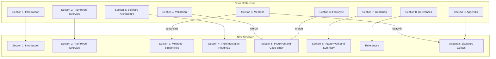

# Document Restructuring Plan

**Version:** 1.0  
**Date:** 2025-03-19  
**Status:** DRAFT - Awaiting User Approval

---

## 1. Executive Summary

This plan restructures the Framework document from its current 9-section format to a streamlined 6-section format plus appendix. The goal is to create a more logical flow: Framework → Methods → Implementation → Validation → Future Work, while moving heavy literature context to an appendix.

---

## 2. Current vs. Proposed Structure

### Current Structure (Framework_draft.docx)

| Section | Title | Lines | Status |
|---------|-------|-------|--------|
| 1 | Introduction | ~50 | Keep as-is |
| 2 | Framework Overview | ~200 | ✅ REVISED (2.1, 2.2 done) |
| 3 | Methods | ~600 | Needs streamlining |
| 4 | Validation & Metrics | ~100 | Merge into new Section 5 |
| 5 | Software Architecture | ~400 | ✅ REVISED (v3 done) |
| 6 | Prototype & Schedule | ~300 | Merge into new Section 5 |
| 7 | Roadmap and Impact | ~100 | Move to new Section 6 |
| 8 | References | ~200 | Keep as-is |
| 9 | Appendix | ~400 | Expand with literature |

### Proposed New Structure

| New # | Title | Source Content | Status |
|-------|-------|----------------|--------|
| 1 | Introduction | Current Section 1 | Keep as-is |
| 2 | Framework Overview | Current Section 2 | ✅ DONE |
| 3 | Methods | Current Section 3 (streamlined) | Needs work |
| 4 | Implementation Roadmap | Current Section 5 | ✅ DONE (v3) |
| 5 | Prototype & Case Study | Current Sections 4 + 6 (merged) | Needs work |
| 6 | Future Work & Summary | Current Section 7 + new conclusion | Needs work |
| - | References | Current Section 8 | Keep as-is |
| A | Appendix: Literature Context | Heavy lit from Section 3 + current Appendix | Needs work |

---

## 3. Section-by-Section Mapping

### 3.1 Section 1: Introduction (NO CHANGE)

**Source:** Current Section 1 (lines 1-50)  
**Action:** Keep as-is  
**Content:**
- Problem statement: surrogate models degrade over time
- Need for systematic recalibration framework
- Document overview

---

### 3.2 Section 2: Framework Overview (✅ COMPLETE)

**Source:** Current Section 2  
**Action:** Replace with revised drafts  
**Files:**
- [`drafts/section2_1_pillars_REVISED.md`](drafts/section2_1_pillars_REVISED.md) - Three-Pillar Architecture
- [`drafts/section2_2_workflow_REVISED.md`](drafts/section2_2_workflow_REVISED.md) - 7-Step Workflow

**Key Changes Already Made:**
- Pillars reframed as "management domains" (not workflow stages)
- New DECIDE step added (Step 3)
- Two-phase workflow structure (Continuous Monitoring + Triggered Response)
- Cross-reference tables linking pillars ↔ workflow steps

---

### 3.3 Section 3: Methods (NEEDS STREAMLINING)

**Source:** Current Section 3 (lines ~200-800)  
**Action:** Streamline; move heavy literature to Appendix

#### Current Section 3 Structure:
```
3.1 Governance (Pillar A)
    - Regulatory requirements
    - Validation protocols
    - Documentation standards

3.2 Modeling Engines (Pillar B)
    - 3.2.1 Surrogate Model Landscape ← MOVE TO APPENDIX
    - 3.2.2 Model Selection Criteria
    - 3.2.3 Uncertainty Quantification

3.3 Recalibration Mechanisms (Pillar C)
    - 3.3.1 Uncertainty Quantification Methods
    - 3.3.2 Trigger Logic
    - 3.3.3 Continual Learning
    - 3.3.4 Active Learning
    - 3.3.5 Multi-Fidelity Fusion
```

#### Content to MOVE TO APPENDIX:

**From Section 3.2.1 (Surrogate Model Landscape):**
- Detailed literature review of surrogate model types (~100 lines)
- Comparison tables of FNO, U-Net, DeepONet, etc.
- Historical context of neural operator development
- Benchmark comparisons from literature

**Estimated lines to move:** ~150-200 lines

#### Content to KEEP in Section 3:

**3.1 Governance (Pillar A):**
- Regulatory requirements (brief)
- Validation protocols (brief)
- Documentation standards (brief)
- Cross-reference to workflow steps

**3.2 Modeling Engines (Pillar B):**
- Model selection criteria (keep)
- UQ integration requirements (keep)
- Brief model type overview (1-2 paragraphs, not full literature review)
- Reference to Appendix for detailed literature

**3.3 Recalibration Mechanisms (Pillar C):**
- All subsections (3.3.1-3.3.5) - KEEP
- These are the core methods referenced by Section 4 (Implementation)

---

### 3.4 Section 4: Implementation Roadmap (✅ COMPLETE)

**Source:** Current Section 5 (Software Architecture)  
**Action:** Replace with revised draft  
**File:** [`drafts/section5_REVISED_v3.md`](drafts/section5_REVISED_v3.md)

**Note:** Rename from "Section 5" to "Section 4" in final assembly

**Key Content:**
- 5.1 Design Philosophy (→ 4.1)
- 5.2 Phase 1 Capabilities: Continuous Monitoring (→ 4.2)
- 5.3 Phase 2 Capabilities: Triggered Response (→ 4.3)
- 5.4 Infrastructure Requirements (→ 4.4)
- 5.5 Development Phases (→ 4.5)
- 5.6 Open Design Questions (→ 4.6)
- 5.7 Summary (→ 4.7)

---

### 3.5 Section 5: Prototype & Case Study (NEEDS WORK)

**Source:** Current Section 4 (Validation & Metrics) + Current Section 6 (Prototype & Schedule)  
**Action:** Merge and restructure

#### Proposed Structure:

```
5.0 Prototype & Case Study

5.1 Validation Framework
    - Performance metrics (from current 4.1)
    - Uncertainty metrics (from current 4.2)
    - Drift detection metrics (from current 4.3)
    - Governance compliance metrics (from current 4.4)

5.2 Prototype Implementation
    - U-FNO prototype (from current 6.1)
    - U-Net prototype (from current 6.2)
    - Integration with workflow steps

5.3 Case Study Design
    - Hydrological modeling scenario
    - Data sources and simulation setup
    - Expected outcomes

5.4 Evaluation Plan
    - Baseline comparison
    - Recalibration effectiveness
    - Computational efficiency
```

#### Content Sources:

**From Current Section 4 (Validation & Metrics):**
- Lines ~800-900 in Framework_draft.docx
- Performance metrics definitions
- Uncertainty calibration metrics
- Drift detection thresholds

**From Current Section 6 (Prototype & Schedule):**
- Lines ~1200-1500 in Framework_draft.docx
- U-FNO architecture details
- U-Net architecture details
- Training procedures
- Schedule/timeline (may move to Section 6)

---

### 3.6 Section 6: Future Work & Summary (NEEDS WORK)

**Source:** Current Section 7 (Roadmap and Impact) + new conclusion  
**Action:** Expand and restructure

#### Proposed Structure:

```
6.0 Future Work & Summary

6.1 Research Roadmap
    - Short-term goals (from current 7.1)
    - Medium-term goals (from current 7.2)
    - Long-term vision (from current 7.3)

6.2 Expected Impact
    - Scientific contributions
    - Operational benefits
    - Broader applications

6.3 Limitations and Open Questions
    - Current framework limitations
    - Areas requiring further research
    - Cross-reference to Section 4.6 (Open Design Questions)

6.4 Conclusion
    - Summary of framework contributions
    - Key takeaways
    - Call to action
```

---

### 3.7 Appendix: Literature Context (NEEDS WORK)

**Source:** Current Appendix + heavy literature from Section 3  
**Action:** Expand with moved content

#### Proposed Structure:

```
Appendix A: Surrogate Model Literature Review
    - A.1 Neural Operator Architectures
        - Fourier Neural Operators (FNO)
        - U-Net and variants
        - DeepONet
        - Transformers for PDEs
    - A.2 Benchmark Comparisons
    - A.3 Application Domains

Appendix B: Paper Review Tables (existing)
    - Table A1: Continual Learning Papers
    - Table A2: Drift Detection Papers
    - (Add more as needed)

Appendix C: Detailed Method Specifications (optional)
    - Extended UQ method details
    - Extended trigger logic specifications
```

---

## 4. Content Movement Summary

### 4.1 Content to MOVE to Appendix

| From | Content | To |
|------|---------|-----|
| Section 3.2.1 | Surrogate model landscape (~150 lines) | Appendix A.1 |
| Section 3.2.1 | Benchmark comparisons | Appendix A.2 |
| Section 3.2.1 | Historical context | Appendix A.1 |

### 4.2 Content to MERGE

| From | To | Notes |
|------|-----|-------|
| Section 4 (Validation) | New Section 5.1 | Validation Framework |
| Section 6 (Prototype) | New Section 5.2-5.4 | Prototype & Case Study |
| Section 7 (Roadmap) | New Section 6.1-6.2 | Future Work |

### 4.3 Content to KEEP AS-IS

| Section | Notes |
|---------|-------|
| Section 1 (Introduction) | No changes needed |
| Section 8 (References) | No changes needed |
| Section 3.3 (Recalibration Mechanisms) | Core methods - keep intact |

---

## 5. Implementation Workflow

### Phase 1: Preparation
- [ ] Create structural skeleton for each new section
- [ ] Identify exact line ranges for content to move
- [ ] Create appendix structure

### Phase 2: Section 3 Streamlining
- [ ] Extract heavy literature content (lines to identify)
- [ ] Create Appendix A with moved content
- [ ] Add cross-references from Section 3 to Appendix
- [ ] Add workflow step cross-references to Section 3

### Phase 3: Section 5 Creation (Merge)
- [ ] Extract validation content from current Section 4
- [ ] Extract prototype content from current Section 6
- [ ] Create merged Section 5 structure
- [ ] Write connecting prose

### Phase 4: Section 6 Creation
- [ ] Extract roadmap content from current Section 7
- [ ] Write new conclusion
- [ ] Add limitations discussion

### Phase 5: Final Assembly
- [ ] Renumber all sections
- [ ] Update all cross-references
- [ ] Verify consistency with design_decisions.md
- [ ] Convert to final format

---

## 6. Structural Skeleton Templates

### Section 3 Skeleton (Streamlined)

```markdown
# 3.0 Methods

This section details the methods organized by the three pillars. For extended 
literature context on surrogate model architectures, see Appendix A.

## 3.1 Governance Methods (Pillar A)

[Brief overview - 2-3 paragraphs]
- Regulatory requirements
- Validation protocols  
- Documentation standards

**Workflow Integration:** Steps 3 (DECIDE) and 7 (DEPLOY)

## 3.2 Modeling Engine Methods (Pillar B)

[Brief overview - 2-3 paragraphs]
- Model selection criteria
- UQ integration requirements
- See Appendix A for detailed architecture comparisons

**Workflow Integration:** Steps 5 (UPDATE) and 6 (CALIBRATE)

## 3.3 Recalibration Mechanism Methods (Pillar C)

### 3.3.1 Uncertainty Quantification
[Keep existing content]

### 3.3.2 Trigger Logic
[Keep existing content]

### 3.3.3 Continual Learning
[Keep existing content]

### 3.3.4 Active Learning
[Keep existing content]

### 3.3.5 Multi-Fidelity Fusion
[Keep existing content]

**Workflow Integration:** All steps, especially Steps 1-3 (monitoring) and 4-6 (update)
```

### Section 5 Skeleton (Merged)

```markdown
# 5.0 Prototype & Case Study

## 5.1 Validation Framework

### 5.1.1 Performance Metrics
[From current Section 4.1]

### 5.1.2 Uncertainty Metrics
[From current Section 4.2]

### 5.1.3 Drift Detection Metrics
[From current Section 4.3]

### 5.1.4 Governance Compliance
[From current Section 4.4]

## 5.2 Prototype Implementation

### 5.2.1 U-FNO Prototype
[From current Section 6.1]

### 5.2.2 U-Net Prototype
[From current Section 6.2]

### 5.2.3 Workflow Integration
[New content linking prototypes to 7-step workflow]

## 5.3 Case Study Design

### 5.3.1 Hydrological Modeling Scenario
[From current Section 6]

### 5.3.2 Data Sources
[From current Section 6]

### 5.3.3 Expected Outcomes
[New content]

## 5.4 Evaluation Plan

### 5.4.1 Baseline Comparison
[New content]

### 5.4.2 Recalibration Effectiveness
[New content]

### 5.4.3 Computational Efficiency
[New content]
```

### Section 6 Skeleton

```markdown
# 6.0 Future Work & Summary

## 6.1 Research Roadmap

### 6.1.1 Short-Term Goals
[From current Section 7]

### 6.1.2 Medium-Term Goals
[From current Section 7]

### 6.1.3 Long-Term Vision
[From current Section 7]

## 6.2 Expected Impact

### 6.2.1 Scientific Contributions
[New/expanded content]

### 6.2.2 Operational Benefits
[New/expanded content]

### 6.2.3 Broader Applications
[New/expanded content]

## 6.3 Limitations and Open Questions

[Cross-reference to Section 4.6]

## 6.4 Conclusion

[New content - summary of framework contributions]
```

---

## 7. Visualization: Document Flow



---

## 8. Questions for User Approval

1. **Section 3 Streamlining:** Is the proposed approach (move ~150-200 lines of surrogate model literature to Appendix A) acceptable?

2. **Section 5 Merge:** Should the merged Prototype & Case Study section include the development timeline/schedule, or should that move to Section 6?

3. **Section 6 Conclusion:** Should the conclusion be a brief summary or a more detailed synthesis of the framework's contributions?

4. **Appendix Structure:** Should we create separate appendices (A, B, C) or keep everything in a single expanded appendix?

5. **Implementation Order:** Preferred order for implementation:
   - Option A: Section 3 first (streamline), then Section 5 (merge), then Section 6
   - Option B: Section 5 first (merge), then Section 3 (streamline), then Section 6
   - Option C: All sections in parallel (create skeletons first, then fill)

---

## 9. Next Steps (Pending Approval)

1. Get user approval on this restructuring plan
2. Identify exact line ranges in Framework_draft.docx for content to move
3. Create structural skeletons for Sections 3, 5, and 6
4. Begin implementation in Code mode

---

## 10. Files Reference

### Completed Drafts (Ready for Assembly)
- [`drafts/section2_1_pillars_REVISED.md`](drafts/section2_1_pillars_REVISED.md)
- [`drafts/section2_2_workflow_REVISED.md`](drafts/section2_2_workflow_REVISED.md)
- [`drafts/section5_REVISED_v3.md`](drafts/section5_REVISED_v3.md) (becomes Section 4)

### Reference Documents
- [`plans/design_decisions.md`](plans/design_decisions.md) - Authoritative guidance
- [`drafts/section3_consistency_notes.md`](drafts/section3_consistency_notes.md) - Methods inventory
- [`drafts/consistency_check.md`](drafts/consistency_check.md) - Consistency requirements

### Source Document
- [`manuscript/Framework_draft.docx`](manuscript/Framework_draft.docx) - Original document
